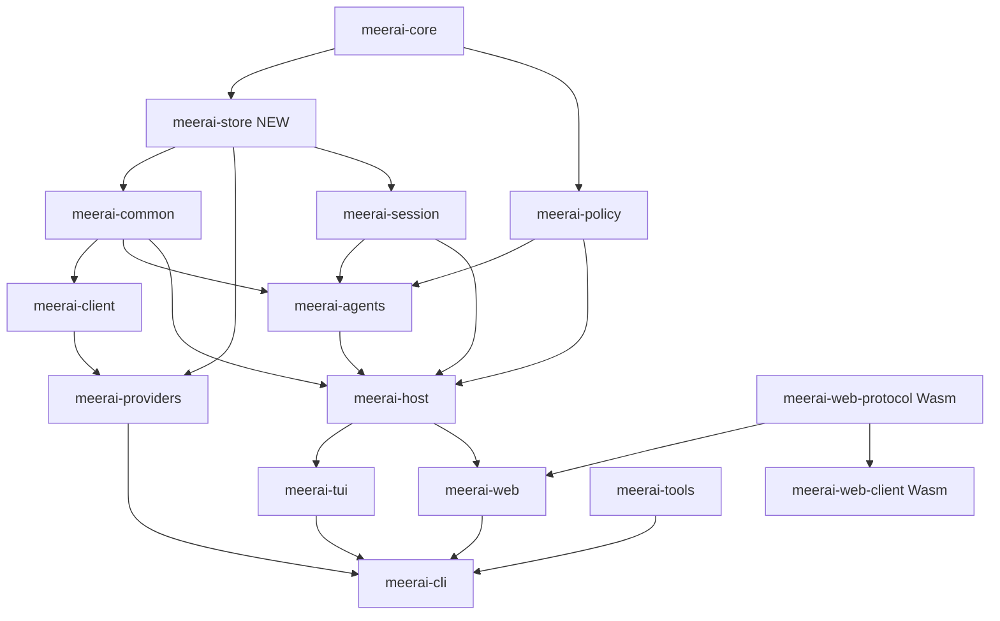

# Implementation Plan: Security Vault, Embedded SQLite Store, and Harness Control Plane

Design and phased execution plan for adding an AEAD credential vault, embedded SQLite storage, cross-session memory, context inspection, manual multi-agent control, custom model routing, and skills/pack management with full TUI and browser UI parity.

| | |
| --- | --- |
| **Status** | Implemented through Phase 5 (2026-11-20), with the prompt-only definition decision. Definitions and trusted packs load prompt text from user-global paths and installed packs; frontmatter `tools`/`permissions`/`allowed-tools` stay warning-only, and pack hooks plus `mcp_servers` are diagnostics only. Legacy JSONL sessions, `meta.json`, file blobs/snapshots, and `open-tabs.json` are removed. Remaining work is listed in [§6 Follow-ups](#6-follow-ups). |
| **Audience** | Contributors, harness/UI authors, security reviewers |
| **Scope** | `meerai-store` (new), `meerai-providers`, `meerai-common`, `meerai-session`, `meerai-agents`, `meerai-host`, `meerai-web-protocol`, `meerai-web`, `meerai-web-client`, `meerai-tui`, `meerai-cli` |
| **Related** | [architecture.md](architecture.md) · [harness-spec.md](harness-spec.md) · [harness-internals.md](harness-internals.md) · [tui-design.md](tui-design.md) · [browser-ui.md](browser-ui.md) · [threat-model.md](threat-model.md) · [AGENTS.md](../AGENTS.md) |

## 1. Overview

This plan upgrades `meerai` from flat-file session/credential storage and single-model turn execution into a unified, SQLite-backed, multi-agent harness with full two-way parity across `meerai-tui` and `meerai-web-client`. Because `meerai` is in active pre-release development, this plan replaces flat-file storage cleanly with **zero legacy migration shims**.

Concretely, this plan covers seven integrated capabilities:

1. **Cross-Platform Keychain Master Key + AEAD Vault:** Generate one 256-bit data-encryption key (DEK) per machine, store it in the OS credential vault (macOS Keychain, Linux Secret Service, Windows Credential Manager), and encrypt all provider API keys and OAuth tokens in SQLite using `chacha20poly1305`.
2. **Embedded SQLite Storage (`meerai-store`):** Replace `session.v<N>.jsonl`, `meta.json`, `auth.json`, `open-tabs.json`, and user `settings.yml` state with an embedded SQLite database (`rusqlite` bundled, WAL + FTS5), while keeping repo-local `.meerai/settings.yml` and `.meerai/hooks.json` as file-based, git-trackable, tighten-only overlays.
3. **Cross-Session Memory:** Persist per-project context, architectural decisions, modified files, and progress across sessions in SQLite (with FTS5 search), automatically fed by compaction/turn summaries and explicit user/tool writes.
4. **Context Management:** Expose real-time per-category token breakdowns (system prompt, tool schemas, messages, tool results, reasoning, cached vs. uncached, watermark headroom) and live compaction/projection controls (`Summarize from here`, focused `/compact`, spill inspection, projection policy toggles) in both TUI and Web.
5. **Multi-Agent Control:** Support manual subagent dispatch, per-subagent model selection, scoped permission/toolset overrides (clamped by `plan` mode and user `deny` rules), cancellation, and live per-child progress + token/cost telemetry in both TUI and Web.
6. **Custom Model Routing:** Add task-type routing (`default`, `explore`, `plan`, `build`, `review`, `compact`, `recovery`, `memory`) with per-route token budgets, USD caps, and `tokio::sync::Semaphore` concurrency limits shared across the main loop and subagents.
7. **Skills & Declarative Pack Management:** Expand `.agents`/`.claude`/user-global skill discovery, supporting-file loading, tool/permission mapping under explicit trust gates, live debugging/diagnostics (`/reload` inspector), and git/version-pinned declarative packs (skills + agents + hooks + MCP server declarations) in both TUI and Web.

## 2. User Review Required & Open Questions

### Key Design Decisions

1. **Embedded Database Engine (`rusqlite` bundled vs. `redb`):** This plan proposes **`rusqlite` with `features = ["bundled"]`** (MIT-compatible with [deny.toml](../deny.toml)). SQLite gives WAL concurrent reads for TUI + `meerai serve`, relational indexes over turns/sessions/memories, and built-in **FTS5** full-text search for messages and cross-session memory. The trade-off is compiling bundled C SQLite (`~1.2 MB` binary growth). Switching to pure-Rust `redb` is the alternative if zero C code is preferred (no SQL/FTS5).
2. **Config Storage Split (SQLite vs. YAML):** User config, routing tables, provider base URLs/recent models, and UI state move into SQLite (`user_config`, `model_routes`), editable directly from TUI/Web Settings and via `meerai config export|import`. Project overlays (`<project-root>/.meerai/settings.yml`, `.meerai/hooks.json`, `AGENTS.md`, `.agents/`, `.claude/`) **remain plain files on disk** so teams can commit them to Git and enforce tighten-only rules ([harness-spec.md](harness-spec.md)).
3. **Keychainless / Headless Linux Fallback:** When no OS keychain is available (headless SSH Linux without D-Bus/Secret Service or `MEERAI_DISABLE_KEYCHAIN=1`), this plan defaults to **requiring `MEERAI_VAULT_PASSPHRASE`** (Argon2id-wrapped DEK) and failing closed rather than silently downgrading to plaintext.
4. **Plugin Scope:** Per [architecture.md](architecture.md), dynamic in-process binary/JS plugins remain a non-goal. "Plugins" in this plan are **version-pinned declarative packs** (skills, agents, hooks, and out-of-process MCP servers) installed from local paths or Git repositories via a lockfile.

### Breaking Changes (Accepted Per "No Legacy Migration" Scope)

- Existing `~/.local/share/meerai/sessions/*.jsonl`, `meta.json`, `open-tabs.json`, `~/.config/meerai/auth.json`, and `~/.config/meerai/settings.yml` will **not** be auto-migrated.
- `SessionEvent`, `AgentEvent`, `AgentCommand`, `SessionItem`, and `meerai-web-protocol` DTOs gain new fields/variants. All consumers (CLI, TUI, Host, Web server, Leptos client, replay) update in lockstep.

### Open Questions

1. **Headless Linux Vault Mode:** If D-Bus `secret-tool` is absent, prefer `MEERAI_VAULT_PASSPHRASE` (fail-closed without passphrase) or an opt-in keyfile (`~/.local/share/meerai/vault.key` at `0600`)?
2. **User YAML Import/Export:** Even without automatic migration, should `meerai config import <path.yml>` / `export` be included for convenience?
3. **Subagent Concurrency Default:** Is a default global cap of `4` concurrent subagent turns (plus per-provider overrides in routing config) appropriate?

## 3. Proposed Architecture & Crate Changes

A new crate `meerai-store` sits directly above `meerai-core` so `meerai-common`, `meerai-providers`, and `meerai-session` can all share the embedded SQLite database without dependency cycles. `meerai-tui` remains decoupled from `meerai-providers` and `meerai-tools`, and `meerai-web-protocol` / `meerai-web-client` remain pure Wasm-safe crates.



### 3.1 Workspace Dependencies & `meerai-store` (Embedded SQLite)

- **Modify [Cargo.toml](../Cargo.toml):** Add `rusqlite` (`bundled`), `chacha20poly1305`, `zeroize`, `argon2`, and Windows-only `windows-sys` (`Win32_Foundation`, `Win32_Security_Credentials`) for `meerai-providers`.
- **New crate `meerai-store`:** Open `$XDG_DATA_HOME/meerai/meerai.db` (or `MEERAI_DB_PATH` / `:memory:` for tests) with `journal_mode = WAL`, `synchronous = NORMAL`, `foreign_keys = ON`, `busy_timeout = 5000`, and `0700`/`0600` Unix permissions via `meerai-core::fs_perms`.

```sql
CREATE TABLE meta (
    key TEXT PRIMARY KEY,
    value TEXT NOT NULL
);

CREATE TABLE vault_secrets (
    provider_id TEXT PRIMARY KEY,
    kind TEXT NOT NULL,            -- 'api' | 'oauth'
    nonce BLOB NOT NULL,           -- 12-byte ChaCha20Poly1305 nonce
    ciphertext BLOB NOT NULL,      -- AEAD encrypted JSON payload (AAD = provider_id)
    updated_at_ms INTEGER NOT NULL
);

CREATE TABLE user_config (
    key TEXT PRIMARY KEY,          -- 'settings', 'ui_tabs', 'trusted_projects'
    json_value TEXT NOT NULL,
    updated_at_ms INTEGER NOT NULL
);

CREATE TABLE model_routes (
    task_type TEXT PRIMARY KEY,    -- 'default','explore','plan','build','review','compact','recovery','memory'
    provider TEXT NOT NULL,
    model TEXT NOT NULL,
    effort TEXT,
    max_tokens_per_turn INTEGER,
    max_cost_usd REAL,
    max_concurrency INTEGER,
    updated_at_ms INTEGER NOT NULL
);

CREATE TABLE sessions (
    id TEXT PRIMARY KEY,
    project_root TEXT NOT NULL,
    cwd TEXT NOT NULL,
    title TEXT,
    model TEXT,
    approval_mode TEXT,
    git_branch TEXT,
    git_sha TEXT,
    forked_from TEXT,
    inherited_event_count INTEGER,
    parent_session_id TEXT,
    harness TEXT,
    remote_session_id TEXT,
    created_at_ms INTEGER NOT NULL,
    updated_at_ms INTEGER NOT NULL
);

CREATE TABLE session_events (
    session_id TEXT NOT NULL REFERENCES sessions(id) ON DELETE CASCADE,
    seq INTEGER NOT NULL,
    ts_ms INTEGER NOT NULL,
    event_type TEXT NOT NULL,
    turn_id TEXT,
    payload_json TEXT NOT NULL,
    PRIMARY KEY (session_id, seq)
);

CREATE VIRTUAL TABLE session_events_fts USING fts5(
    session_id UNINDEXED,
    seq UNINDEXED,
    text_content
);

CREATE TABLE session_blobs (
    session_id TEXT NOT NULL REFERENCES sessions(id) ON DELETE CASCADE,
    blob_key TEXT NOT NULL,
    byte_len INTEGER NOT NULL,
    content_zstd BLOB NOT NULL,
    created_at_ms INTEGER NOT NULL,
    PRIMARY KEY (session_id, blob_key)
);

CREATE TABLE session_snapshots (
    session_id TEXT NOT NULL REFERENCES sessions(id) ON DELETE CASCADE,
    turn_id TEXT NOT NULL,
    rel_path TEXT NOT NULL,
    existed INTEGER NOT NULL,
    content_zstd BLOB,
    created_at_ms INTEGER NOT NULL,
    PRIMARY KEY (session_id, turn_id, rel_path)
);

CREATE TABLE project_memories (
    id TEXT PRIMARY KEY,
    project_root TEXT NOT NULL,
    kind TEXT NOT NULL,            -- 'decision' | 'progress' | 'fact' | 'convention'
    title TEXT NOT NULL,
    body TEXT NOT NULL,
    source_session_id TEXT,
    pinned INTEGER NOT NULL DEFAULT 0,
    created_at_ms INTEGER NOT NULL,
    updated_at_ms INTEGER NOT NULL
);

CREATE VIRTUAL TABLE project_memories_fts USING fts5(
    id UNINDEXED,
    project_root UNINDEXED,
    title,
    body
);

CREATE TABLE installed_packs (
    id TEXT PRIMARY KEY,
    source_kind TEXT NOT NULL,     -- 'git' | 'local'
    source_uri TEXT NOT NULL,
    pinned_rev TEXT NOT NULL,      -- git commit SHA or version tag
    manifest_json TEXT NOT NULL,
    enabled INTEGER NOT NULL DEFAULT 1,
    trusted INTEGER NOT NULL DEFAULT 0,
    installed_at_ms INTEGER NOT NULL,
    updated_at_ms INTEGER NOT NULL
);

CREATE TABLE usage_ledger (
    id INTEGER PRIMARY KEY AUTOINCREMENT,
    session_id TEXT NOT NULL REFERENCES sessions(id) ON DELETE CASCADE,
    parent_session_id TEXT,
    turn_id TEXT,
    agent_id TEXT,
    task_type TEXT,
    provider TEXT NOT NULL,
    model TEXT NOT NULL,
    prompt_tokens INTEGER NOT NULL,
    completion_tokens INTEGER NOT NULL,
    cached_tokens INTEGER NOT NULL,
    est_cost_usd REAL,
    ts_ms INTEGER NOT NULL
);
```

### 3.2 Self-Generated Keychain Master Key + AEAD Vault

- **Modify [secrets.rs](../meerai-providers/src/secrets.rs) and [meerai-providers/Cargo.toml](../meerai-providers/Cargo.toml):**
  - Store a single 256-bit DEK under service `"meerai"`, account `"vault-master-key-v1"`, generated via `getrandom` on first write and wrapped in `Zeroizing`.
  - **macOS:** `/usr/bin/security` (`find-generic-password`, `add-generic-password`, `delete-generic-password`).
  - **Linux:** `secret-tool` over D-Bus (`lookup`, `store`, `clear`).
  - **Windows:** Implement `NativeKeychainBackend` via `windows-sys` (`CredReadW`, `CredWriteW`, `CredDeleteW`, `CredFree`), replacing the unsupported stub.
  - **Vault (`VaultSecretStore` implementing `SecretStore`):** Encrypt both `Credential::ApiKey` and `Credential::OAuth` (closing the plaintext `auth.json` OAuth gap in [threat-model.md](threat-model.md)) using `ChaCha20Poly1305` with a fresh 96-bit `getrandom` nonce per write and `provider_id` as AAD. Persist in `vault_secrets` using SQLite `BEGIN IMMEDIATE` transactions instead of `auth.json.lock`.
  - **Headless fallback:** Derive the 32-byte key from `MEERAI_VAULT_PASSPHRASE` via `argon2` + per-DB salt in `meta`, or fail closed with an actionable error. Keep `MemorySecretStore` in [meerai-client/src/secrets.rs](../meerai-client/src/secrets.rs) for tests.

### 3.3 SQLite Session & Config Persistence

- **Modify [session.rs](../meerai-session/src/session.rs), [blob.rs](../meerai-session/src/blob.rs), [snapshot.rs](../meerai-session/src/snapshot.rs):**
  - Move session metadata, append-only `SessionEvent` rows, spilled zstd blobs, and turn snapshots to `meerai-store`.
  - Keep idempotent crash healing on `Session::open`, pure `derive_messages(events, policy)` in [projection.rs](../meerai-session/src/projection.rs), and `replay_from_events` in [replay.rs](../meerai-session/src/replay.rs).
  - Add `Session::search_events(query)` over `session_events_fts` and `meerai sessions export <id> --jsonl`.
- **Modify [settings.rs](../meerai-common/src/settings.rs) and [tabs.rs](../meerai-tui/src/tabs.rs):**
  - Store user `AppSettings`, `ModelRoutingSettings`, `HooksSettings`, and open tab state in `meerai-store` (`user_config`, `model_routes`).
  - Keep `<project-root>/.meerai/settings.yml` and `<project-root>/.meerai/hooks.json` file-based and tighten-only (project files cannot override `active_provider`, `active_model`, `providers`, `routing`, `approval_mode`, `sessions`, or `hooks` trust).

### 3.4 Cross-Session Memory

- **Modify [event.rs](../meerai-session/src/event.rs), [prompt.rs](../meerai-agents/src/prompt.rs), [compaction.rs](../meerai-agents/src/multi_turn_agent/compaction.rs); add `meerai-agents/src/memory.rs`:**
  - `ProjectMemory` keyed by canonical `project_root` with `kind` (`Decision | Progress | Fact | Convention`), `title`, `body`, `source_session_id`, `pinned`.
  - **Capture:** Auto-extract structured items from `CompactionSummary` / turn completion (when `context.auto_memory` is enabled), plus `MemoryToolset` (`memory-search`, `memory-save`, `memory-delete` using `#[derive(Toolset)]`, blocked in `plan` mode) and `/remember` / `/memory`.
  - **KV-Cache Safe Injection:** `compose_system_prompt` appends a bounded pinned/recent memory section (default 8 KiB) after root `AGENTS.md`, screened with `screen_untrusted_text`.

### 3.5 Context Management & Inspection

- **Modify [projection.rs](../meerai-session/src/projection.rs), [mod.rs](../meerai-agents/src/multi_turn_agent/mod.rs), [events.rs](../meerai-agents/src/events.rs):**
  - Compute `ContextBreakdown`: `context_window_tokens`, `high_watermark_tokens`, `estimated_total_tokens`, per-bucket token counts (`system_prompt`, `tool_schemas`, `memory`, `user_messages`, `assistant`, `tool_results`, `reasoning`, `compaction_summary`), `spilled_blob_count`, `cleared_tool_results_count`, `pinned_turn_ids`, `last_prompt_cached_tokens`.
  - Extend `AgentCommand`: `Compact { focus: Option<String>, from_turn_id: Option<TurnId> }` (adds custom compaction focus and `Summarize from here`), `SetProjectionOverrides { verbatim_window_turns, reasoning_pruning, clear_old_tool_results, pin_turns }`, `InspectContext`.
  - Add `SessionEvent::ContextTurnPinned { turn_id, pinned }` and `AgentEvent::ContextUpdated { breakdown }`.

### 3.6 Multi-Agent Control & Custom Model Routing

- **Modify [settings.rs](../meerai-common/src/settings.rs), [harness.rs](../meerai-agents/src/harness.rs), [subagent.rs](../meerai-agents/src/subagent.rs), [events.rs](../meerai-agents/src/events.rs); add `meerai-agents/src/routing.rs`:**
  - **Routing (`ModelRoute`):** Map `TaskType` (`Default | Explore | Plan | Build | Review | Compact | Recovery | Memory | Custom(String)`) to `{ provider, model, effort, max_tokens_per_turn, max_cost_usd, max_concurrency }`. Project `.meerai/settings.yml` cannot set or override routes.
  - **Concurrency & Spend Enforcement (`RoutingCoordinator`):** Share per-provider and global `tokio::sync::Semaphore` permits across the main turn and subagents; enforce `max_cost_usd` via `ApprovalKind::Spend`.
  - **Manual Subagent Control:** Extend `SubagentRunArgs` and add `AgentCommand::SpawnSubagent` + `AgentCommand::CancelSubagent { item_id }` with optional `model`, `approval_mode` (clamped by parent `plan` mode and user `deny` rules), `allowed_tools`, `max_steps`, `max_tokens`, and `max_cost_usd`.
  - **Live Telemetry:** Extend `SessionItem::SubagentRun` and `ItemDelta::SubagentProgress` (adjacent tagging `tag = "type", content = "data"`) with `model`, `approval_mode`, `steps_used`, `max_steps`, `usage`, `est_cost_usd`, and `active_tool`.

### 3.7 Skills & Declarative Pack Management

- **Modify [definitions.rs](../meerai-common/src/definitions.rs), [hooks.rs](../meerai-common/src/hooks.rs); add `meerai-common/src/packs.rs`:**
  - Discover definitions across user-global `~/.config/meerai/{skills,agents}`, trusted installed packs in `~/.local/share/meerai/packs/<id>/`, and project `.meerai/` then `.agents/` / `.claude/` (see [AGENTS.md](../AGENTS.md)).
  - Track diagnostics (`source_path`, `shadowed_by`, `token_estimate`, `parse_warnings`, `supporting_files`).
  - Keep `tools` and `allowed-tools` warning-only; agent `permissions` join a subagent's policy and drop `allow`, so a definition tightens only (prompt-only rule in [AGENTS.md](../AGENTS.md)). Pack hooks and `mcp_servers` declarations are validated and shown in diagnostics, but they are not executed or connected.
  - **Version-Controlled Packs (`meerai-pack.yml`):** Declare `name`, `version`, `skills`, `agents`, `hooks`, `mcp_servers`. Manage via `git2` (pinned commit SHA in `installed_packs`) and expose CLI (`meerai pack add|list|update|pin|trust|remove`) + Host/TUI/Web UI.

### 3.8 Host, Web Protocol, TUI, and Web Client Parity

- **Modify [meerai-host/src/session.rs](../meerai-host/src/session.rs) & [registry.rs](../meerai-host/src/registry.rs):** Add `SessionOpener` methods for memories, routes, packs, definitions diagnostics, spill blobs, and open tabs; update `SessionRegistry` live view & `LiveEntry::Subagent`.
- **Modify [meerai-web-protocol/src/lib.rs](../meerai-web-protocol/src/lib.rs), [meerai-web/src/server.rs](../meerai-web/src/server.rs), [mapper.rs](../meerai-web/src/mapper.rs):** Add Wasm-safe DTOs, `ViewEvent` variants, and authenticated loopback HTTP endpoints (`/api/memories`, `/api/routes`, `/api/packs`, `/api/definitions/diagnostics`, `/api/sessions/{id}/context`, `/api/sessions/{id}/compact`, `/api/sessions/{id}/subagents`).
- **Modify `meerai-tui` & `meerai-web-client`:** Deliver matching interactive modals/panels for:
  1. `/context` — token breakdown vs. watermark, projection toggles, blob viewer, turn pinning, focused `/compact`, `Summarize from here`.
  2. `/memory` & `/remember` — search, pin, edit, delete project memories.
  3. `/subagent` & `SubagentOverlay` / Web Inspector — manual spawn (task, agent, model, permissions, budgets), live step/token/cost progress, individual cancel, child transcript inspection.
  4. `/routing` & Settings — task-type model/budget/concurrency editor.
  5. `/skills` & `/packs` — discovery diagnostics, warnings, token footprint, `/reload` status, pack install/pin/trust/toggle.
- **Modify [meerai-cli/src/main.rs](../meerai-cli/src/main.rs) & [cli.rs](../meerai-cli/src/cli.rs):** Wire `meerai-store` and `VaultSecretStore`, update `COMMANDS`/`TUI_COMMANDS`/`OPTIONS` help tables, and add `memory`, `routes`, `pack`, and `sessions export` subcommands.
- **Update docs in the same change:** [README.md](../README.md), [architecture.md](architecture.md), [harness-spec.md](harness-spec.md), [harness-internals.md](harness-internals.md), [tui-design.md](tui-design.md), [browser-ui.md](browser-ui.md), [threat-model.md](threat-model.md), and [.agents/repo/profile.md](../.agents/repo/profile.md).

## 4. Phased Execution Order

1. **Phase 1 — `meerai-store` + Keychain DEK / AEAD Vault:** SQLite schema + `VaultSecretStore` (macOS/Linux/Windows) + unit tests.
2. **Phase 2 — Session, Config, and Cross-Session Memory Persistence:** Move `Session`, `AppSettings`, open tabs, and `ProjectMemory` onto `meerai-store`; keep `.meerai/` project overlays file-based and tighten-only.
3. **Phase 3 — Routing, Concurrency, Multi-Agent Control & Context Engine:** `ModelRoute` + `Semaphore` coordinator + `SpawnSubagent`/`CancelSubagent` + `ContextBreakdown` + `Pack` loader.
4. **Phase 4 — Host, Web Protocol, Server, Leptos Web Client, and TUI Parity:** Implement all five UI surfaces in `meerai-host`, `meerai-web-protocol`, `meerai-web`, `meerai-web-client`, and `meerai-tui`.
5. **Phase 5 — CLI Wiring, Docs, and Full CI Gate Verification.**

## 5. Verification Plan

### Automated Verification

Run after each phase and after the final edit (matching [.github/workflows/ci.yml](../.github/workflows/ci.yml)):

```sh
make verify
cargo check -p meerai-cli --no-default-features
cargo check -p meerai-tui --no-default-features
cargo check -p meerai-web-client --target wasm32-unknown-unknown
python3 scripts/build-web.py
cargo deny check
```

Add targeted test suites for:
- `meerai-store`: WAL concurrency, FTS5 search (`session_events_fts`, `project_memories_fts`), cascade deletes, `0600` file permissions.
- `meerai-providers`: DEK generation, `ChaCha20Poly1305` encryption/decryption, tamper/wrong-AAD rejection, mock keychain backend, headless passphrase KDF fallback.
- `meerai-common`: tighten-only overlay dropping project `routing` and escalating `pack` rules.
- `meerai-agents`: semaphore concurrency enforcement across parallel subagents, `max_cost_usd` Spend gate, `SpawnSubagent` clamping under `plan` mode, `ContextBreakdown` calculation, `Summarize from here` boundary safety.
- `meerai-web-protocol`, `meerai-web`, `meerai-tui`, `meerai-web-client`: serde round-trips, HTTP route handlers, TUI modal/command tests, Wasm reducer tests.

### Manual Verification

1. **Credential Vault:** Run `meerai auth login openai`, inspect `meerai.db` with `sqlite3` to verify `vault_secrets.ciphertext` is encrypted and no plaintext `auth.json` exists.
2. **TUI Parity (`cargo run -p meerai-cli --features web`):** Exercise `/context`, `/memory`, `/remember`, `/subagent` (manual spawn, live token/step progress, cancel), `/routing`, `/skills`, `/packs`, and `/reload`.
3. **Browser UI Parity (`make serve`):** Authenticate via Basic auth and exercise the same five workflows while verifying live synchronization with an attached TUI session.

### Last verification (2026-11-20)

| Gate | Command | Result |
| --- | --- | --- |
| Format | `cargo fmt --all -- --check` | pass |
| Lint | `cargo clippy --workspace --all-targets` | pass; warnings only |
| Tests | `cargo test --workspace` | pass |
| Headless surface | `cargo check -p meerai-cli --no-default-features` | pass |
| TUI without update | `cargo check -p meerai-tui --no-default-features` | pass |
| Wasm client | `cargo check -p meerai-web-client --target wasm32-unknown-unknown` | pass |
| Browser bundle | `python3 scripts/build-web.py` | pass |
| Dependency audit | `cargo deny check` | not run (`cargo-deny` not installed) |

## 6. Follow-ups

The plan is implemented. These items remain and are out of the current change.

### UI parity

- Memory editing: both clients list, search, pin, and delete. Neither exposes a title, body, or kind edit form.
- TUI Packs panel: install and pin work through the `/pack add|pin` commands. The panel has no install or pin input. The browser Packs panel has both forms.
- Browser Context panel: pin and summarize are per-turn buttons. There is no click-to-select turn; the TUI uses `j`/`k` selection.
- `meerai pack update` is not implemented. `add`, `list`, `enable`, `disable`, `trust`, `untrust`, `pin`, and `remove` are.

### Data model

- `sessions.project_root` stores the workspace path, not the repository root.
- `usage_ledger` is written per step but not read back. The USD cap is per-process, so a restart resets the routing spend counter.
- Fork copies the preserved events in one transaction. The child `sessions` row is inserted before that transaction, so a failure can leave an empty child.
- `session_events_fts` is queried by `Session::search_events`. No CLI, TUI, or Web surface calls it yet.

### Wire contracts

- Subagent progress uses `EntryUpdated`. `ViewEvent::SubagentProgressed`, `MemoriesUpdated`, `RoutesUpdated`, and `PacksUpdated` are not separate variants.
- Resource mutations use the shared `POST /api/actions` executor. `/api/memories`, `/api/routes`, `/api/packs`, `/api/sessions/{id}/subagents`, and `/api/sessions/{id}/context-policy` are not dedicated REST routes.

### Definitions and packs

- Definitions diagnostics list agents, skills, warnings, shadows, token estimates, and supporting files, but not hooks.
- Pack hooks and `mcp_servers` are diagnostics only. Activating hooks needs the existing hook trust gate; MCP needs a client runtime and a new trust boundary.
- `tools`, `permissions`, and `allowed-tools` remain warning-only by design.

### Verification gaps

- `cargo deny check` was not run here because `cargo-deny` is not installed.
- No live-provider run and no manual TUI or browser session was performed in this change.
